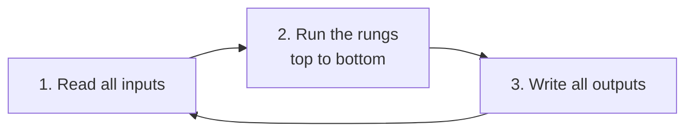

# 01. What a PLC is and how it thinks

A **PLC** (Programmable Logic Controller) is a small rugged computer that
reads switches and sensors, decides, and switches motors, lamps and valves.
Factories use it instead of a laptop because it survives heat, dust and
electrical noise, and because it runs one program forever, in a loop, with
predictable timing.

## Inputs and outputs

Every wire on a PLC has an **address**:

| Address | Meaning | Example on the revision sheet |
|---|---|---|
| `I0.0`, `I0.1`, ... | input bits: a button, a switch, a sensor | `I0.0` start, `I0.1` stop |
| `Q0.0`, `Q0.1`, ... | output bits: a lamp, a relay, a motor contactor | `Q0.0` motor M1 |
| `T0.0`, `T0.1`, ... | timer done bits | `T0.0` "10 s have passed" |
| `C0.0`, ... | counter done bits | `C0.0` "10 boxes counted" |

`I0.2` reads as "input byte 0, bit 2". Each bit is only ever 0 or 1.

### Wiring, as drawn on the sheet

```text
   INPUT CARD                          OUTPUT CARD
 +--------+                          +--------+
 |  I0.0  |----o start o----+        |  Q0.0  |----[ M1 ]----+
 |  I0.1  |----o stop  o----+        |  Q0.1  |----[ M2 ]----+
 |  I0.2  |----o sensor o---+        |  Q0.2  |----[ M3 ]----+
 |  COM   |----------| +  - |--+     |  COM   |-----| +  - |-+
 +--------+          supply            +--------+       supply
```

Every button is wired between an input and the supply, and the supply closes
the loop through `COM`. Pressing the button lets current flow, and the PLC
reads that input as 1. The output side works the same way: when the program
sets `Q0.0` to 1, the PLC closes that output and M1 gets power.

**A note on buttons.** The stop button on the sheet is a normal push button
(wired open). The program uses it through a normally closed *contact*, which
the next lesson explains. In real plants the stop button is often wired
normally closed so a broken wire also stops the machine. This course follows
the sheet and keeps every button wired open.

## The scan cycle

A PLC does not react to a button "instantly". It repeats three steps, forever:



One trip round the loop is one **scan**, usually a few milliseconds. Two facts
about step 2 matter again and again in this course:

1. Rungs run **in order, top to bottom**.
2. When a rung changes a bit, every rung **below it in the same scan** already
   sees the new value.

Lesson 05 shows a program from the sheet that works only because of fact 2,
and breaks when you move one rung.

## The simulator used in this course

Real PLC software is different on every brand, so every example here runs on a
small Python simulator in [`plc/`](../plc/__init__.py). A ladder program is a
Python function, one line per rung, and the simulator calls it once per scan
(10 ms by default):

```python
def program(p):
    p.coil("Q0.0", p.NO("I0.0"))      # lamp follows the button
```

`p.NO(...)` is a normally open contact, `p.NC(...)` a normally closed one, and
`p.coil(...)` an output. Timers and counters come in lessons 04 and 05. Every
table you see in these lessons is printed by a script in
[`examples/`](../examples), and CI re-runs them all on every push.

**Timer units.** Presets in this course are in **milliseconds**, as on the
revision sheet, so `10000` means 10 seconds. On a Siemens S7-200 with a 100 ms
timer (T37 and up) the same 10 s is written `PT = 100`. Check your
simulator's timer resolution before you copy a preset.

**Next:** [02. Contacts, coils and the seven gates](02-contacts-and-gates.md)
